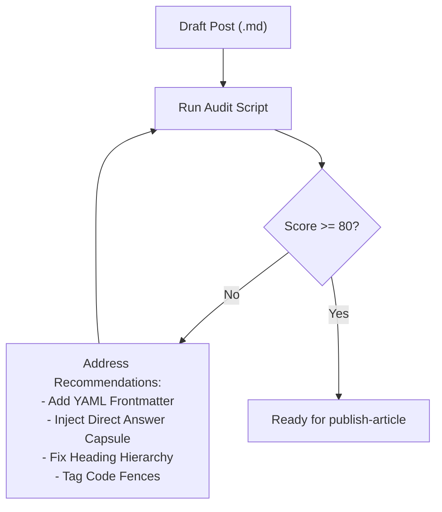

# Optimize Article Skill

This skill guides the audit, refinement, and optimization of blog posts for **The AI Artisan Notes** before publishing. It ensures high search visibility, accurate AI bot citations, and consistent craftsmanship.

---

## The Optimization Spectrum

Modern technical writing must serve two audiences simultaneously:
1. **Human Craftsmen & Traditional Search Engines (SEO)**: Clear prose, captivating titles, accurate meta descriptions, semantic heading hierarchies, and rich link graphs.
2. **Generative Engines & AI Bots (GEO / AEO)**: Extractable direct-answer capsules (TL;DRs), high-confidence claim-evidence pairings, structured comparison tables, schema markup, and syntax-tagged code snippets.



---

## Step 1: Run the Automated Auditor

Run the built-in auditor on your Markdown file:

```bash
python .agents/skills/optimize-article/scripts/audit-post.py content/posts/YYYY-MM-DD-<slug>.md
```

The script evaluates:
- Frontmatter completeness (`title`, `slug`, `date`, `description`, `tags`)
- Title length (sweet spot: 35–75 characters)
- Meta description length (110–165 characters for search snippet CTR)
- Heading hierarchy (ensures no `H1 (#)` exists in body; uses `H2 (##)` and `H3 (###)`)
- GEO Direct Answer Capsule presence
- Code fence language tagging
- Anchor text quality (flags generic "click here" or raw URLs)

---

## Step 2: Apply SEO Optimizations

1. **Title Tag Craft**:
   - Ensure the `title` frontmatter is 40–70 characters long.
   - Include primary search terms naturally (e.g. "Unit Tests", "AI Pair Programming", "Agent Architecture").
   - Pair a bold claim with an architectural truth.

2. **Meta Description**:
   - 130–160 characters long.
   - Summarize the specific technical problem and the proposed shift in thinking.
   - Example: *"An exploration of why AI-driven code generation breaks legacy unit testing dogmas, why the test pyramid becomes a diamond, and how spec-based tests save the craft."*

3. **Semantic Hierarchy**:
   - Never place an `# H1` in the Markdown body. The publishing template renders the `title` frontmatter as the single `<h1>`.
   - Start article sections with `## H2`.
   - Sub-sections use `### H3`.

---

## Step 3: Apply Generative Engine Optimization (GEO / AEO)

AI crawlers (Perplexity, ChatGPT, Claude, Copilot, Google AI Overviews) index articles by searching for concise, authoritative answers to query intents.

1. **Direct Answer Capsule (TL;DR / Key Takeaways)**:
   - Place a highlighted direct-answer block within the first 3 paragraphs.
   - Formulate the answer using explicit entity-predicate relationships.
   - See [Answer Capsule Templates](file:///C:/Workspace/the-ai-artisan-notes/.agents/skills/optimize-article/resources/answer-capsule-templates.md) for ready-to-use patterns.

2. **Structured Tables & Contrast Lists**:
   - Tabular comparisons (e.g. *Legacy Approach vs. AI Era*) receive extraordinarily high extraction weights in AI summaries.
   - Bold the key takeaway in each list item.

3. **Syntax-Explicit Code Blocks**:
   - Always declare language specifiers: ` ```csharp `, ` ```python `, ` ```bash `, ` ```typescript `.
   - This enables AST parsers in coding agents to ingest and index code examples accurately.

---

## Step 4: Verification Checklist

Before passing the article to `publish-article`:
- [ ] Auditor score is >= 80/100 (`audit-post.py` exits with 0).
- [ ] YAML frontmatter contains: `title`, `slug`, `date`, `description`, `tags`.
- [ ] First section features a Direct Answer Capsule (TL;DR).
- [ ] Headings follow `##` and `###` exclusively.
- [ ] All code fences specify a language.
- [ ] Internal/external links use descriptive anchor text.
