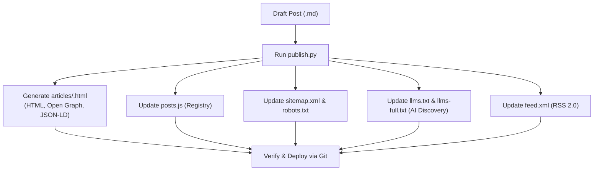

# Publish Article Skill

This skill transforms Markdown drafts from `content/posts/` into static, semantic HTML files in `articles/` equipped with full SEO metadata, Schema.org JSON-LD, Open Graph tags, and auto-generates discovery files for human readers and AI crawlers.

---

## Publishing Workflow



---

## Automated Publishing

A zero-dependency Python script using only standard library modules handles the entire static build:

```bash
python .agents/skills/publish-article/scripts/publish.py --all
```

Or publish a single file:

```bash
python .agents/skills/publish-article/scripts/publish.py content/posts/YYYY-MM-DD-<slug>.md
```

### Generated Artifacts
1. **`articles/<slug>.html`**:
   - Clean semantic HTML structure.
   - Canonical URL tag.
   - Open Graph & Twitter Cards for social sharing.
   - Schema.org `TechArticle` JSON-LD structured data linking author identity to LinkedIn and GitHub.
2. **`posts.js`**: Synchronized dynamic registry sorted chronologically.
3. **`sitemap.xml`**: Standard search engine sitemap with `lastmod` dates.
4. **`robots.txt`**: Crawl policy explicitly welcoming AI bots (`GPTBot`, `ClaudeBot`, `PerplexityBot`, `Google-Extended`).
5. **`llms.txt` & `llms-full.txt`**: Emerging web standard ([llmstxt.org](https://llmstxt.org)) for LLMs and AI agent crawlers.
6. **`feed.xml`**: Standard RSS 2.0 feed for news aggregators and syndication readers.

---

## Verification Checklist

Before pushing to `main`:
- [ ] `articles/<slug>.html` renders properly in browser.
- [ ] `posts.js` contains the new post.
- [ ] `sitemap.xml`, `robots.txt`, `llms.txt`, and `feed.xml` are updated.
- [ ] Commit and push to `main` to trigger the GitHub Pages deployment.
