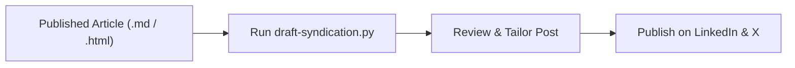

# Syndicate Article Skill

This skill transforms published field notes into distribution assets for LinkedIn and X (formerly Twitter). It focuses on craft, engineering debate, and actionable shifts rather than marketing hype.

---

## Workflow Steps



---

## 1. Automated Generation

Run the syndication tool on the target post:

```bash
python .agents/skills/syndicate-article/scripts/draft-syndication.py content/posts/YYYY-MM-DD-<slug>.md
```

This generates:
- A structured **LinkedIn post draft** with problem tension, TL;DR answer, bullet points, and discussion question.
- A 4-part **X/Twitter thread draft** with a strong hook, the friction story, the architectural shift, and link to the essay.

---

## 2. Platform Tone Guidelines

### LinkedIn Strategy
- **Tone**: Thoughtful tech lead, respectful of history, honest about real-world friction.
- **Formatting**: Short 1-2 sentence paragraphs with whitespace. No walls of text.
- **The Hook**: Start with a counter-intuitive observation or real debugging failure.
- **The Engagement Hook**: End with a genuine question asking how other leads/teams handle the trade-off.

### X / Twitter Thread Strategy
- **Tweet 1 (Hook)**: One crisp claim, thesis statement, and thread emoji `🧵`.
- **Tweet 2 (The Story)**: The real production friction that triggered the insight.
- **Tweet 3 (The Shift)**: The core mental model or architectural takeaway.
- **Tweet 4 (The Artifact)**: Link to the full note on `https://bchir.github.io/the-ai-artisan-notes/`.

---

## 3. Verification Checklist

- [ ] Canonical URL links to the live published article.
- [ ] No generic AI clichés (e.g. "Game changer!", "Dive deep!", "In today's fast-paced world").
- [ ] Direct Answer / TL;DR is highlighted for fast skimmers.
