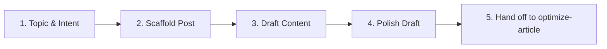

# Write Article Skill

This skill guides the AI and user through writing high-quality, craft-focused technical articles and essays for **The AI Artisan Notes**.

---

## Workflow Steps



### 1. Topic & Intent Framing
Before writing, clarify the article's core proposition:
- **Title / Working Concept**: What is the core question or solution?
- **Audience**: AI engineers, developers, technical founders, curious craftsmen.
- **Article Type**:
  - *Deep-Dive / Breakdown*: Architectural analysis or underlying mechanics.
  - *Tutorial / Walkthrough*: Step-by-step implementation with code.
  - *Artisan Essay / Perspective*: Thoughtful commentary on AI trends, workflows, and craftsmanship.
  - *Case Study / Build Log*: Real-world experience building or debugging systems.
- Consult the [Style & Tone Guide](file:///C:/Workspace/the-ai-artisan-notes/.agents/skills/write-article/references/style-guide.md) to match the blog's voice.

### 2. Scaffold the Markdown File
Create a new file in `content/posts/` named:
```
content/posts/YYYY-MM-DD-<slug>.md
```
Or run the helper script:
```bash
node .agents/skills/write-article/scripts/new-post.js "Your Article Title"
```

Verify that the file includes the required YAML frontmatter based on the [Frontmatter Schema](file:///C:/Workspace/the-ai-artisan-notes/.agents/skills/write-article/references/frontmatter-schema.md). See the [Article Template](file:///C:/Workspace/the-ai-artisan-notes/.agents/skills/write-article/resources/article-template.md) for the default layout.

### 3. Draft Content
Follow the structural rhythm:
1. **The Hook / The Premise**: Grab the reader's attention with a real dilemma, trend, or craft challenge.
2. **Context & Foundation**: Set up the constraints or background without unnecessary history lessons.
3. **The Core Craft / Technical Core**: The meat of the article—architecture, code, patterns, or analysis.
4. **Pragmatic Nuances & Trade-offs**: What breaks? When shouldn't you do this? What did experience teach you?
5. **Key Takeaways / Conclusion**: A memorable summary, mental model, or parting thought.

### 4. Polish & Verification Checklist
Before marking `draft: false`:
- [ ] **Frontmatter Complete**: Valid YAML, accurate date, tags, and 1-2 sentence description.
- [ ] **Headings**: Use `##` (H2) and `###` (H3). Avoid using `#` (H1) inside the body (the template uses the `title` frontmatter as H1).
- [ ] **Code Blocks**: Always include language specifiers (e.g. ` ```python `, ` ```typescript `).
- [ ] **Tone Check**: Clear, direct, artisanal, and grounded in practical reality—avoid generic AI hype and clichés.
- [ ] **Links**: Ensure internal and external links are valid markdown hyperlinks.

---

## Next Workflow Step

Once the draft is ready, proceed to [optimize-article](file:///C:/Workspace/the-ai-artisan-notes/.agents/skills/optimize-article/SKILL.md) to audit SEO metadata, inject Direct Answer Capsules for AI engines (GEO), and verify heading hierarchy before publishing.
