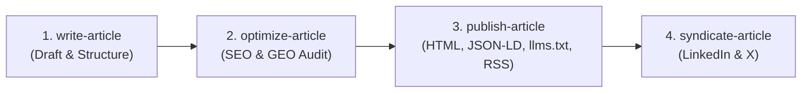

# The AI Artisan Notes

> A digital notebook sharing a practitioner's vision, field experiments, and reflections on how software engineering craft and standards are evolving in the age of AI. Hosted directly on GitHub Pages.

---

## Zero-Node, Zero-Dependency Architecture

This site intentionally avoids heavy frameworks and npm dependencies. It is built purely with semantic HTML, vanilla CSS, and browser-native JavaScript:

```text
the-ai-artisan-notes/
├── index.html                     # Homepage (The AI Artisan Notes)
├── posts.js                       # Post registry array loaded by index.html
├── sitemap.xml                    # Standard XML sitemap with lastmod dates
├── robots.txt                     # Crawler policy (welcomes GPTBot, ClaudeBot, PerplexityBot)
├── llms.txt & llms-full.txt       # Standard AI agent discovery index (llmstxt.org)
├── feed.xml                       # RSS 2.0 syndication feed
├── assets/
│   └── style.css                  # Minimalist, responsive craft styling (Dark/Light)
├── articles/
│   └── unit-tests-are-dead.html   # Published semantic HTML articles (Schema.org & OpenGraph)
├── content/
│   └── posts/                     # Source Markdown articles with frontmatter
├── .github/
│   └── workflows/
│       └── deploy.yml             # Lightweight, zero-build GitHub Pages deployment
├── .agents/
│   └── skills/
│       ├── write-article/         # 1. Drafting, outlining, and structuring posts
│       ├── optimize-article/      # 2. SEO & AI Bot Read (GEO) audit and answer capsules
│       ├── publish-article/       # 3. HTML compilation, JSON-LD, sitemap, llms.txt & RSS
│       └── syndicate-article/     # 4. LinkedIn & X/Twitter thread derivation
├── LICENSE                        # Dual license: CC BY 4.0 (articles) & MIT (tooling)
└── README.md
```

---

## The 4-Stage Publishing Workflow



### 1. Write an Article (`write-article` skill)
Draft your post in Markdown inside `content/posts/` using standard frontmatter:
```bash
# Antigravity will use the write-article skill to brainstorm, outline, and draft
```

### 2. Audit & Optimize (`optimize-article` skill)
Run the automated auditor to check SEO snippet length, heading hierarchy, code fence tagging, and AI answer capsules:
```bash
python .agents/skills/optimize-article/scripts/audit-post.py content/posts/YYYY-MM-DD-<slug>.md
```

### 3. Publish to HTML & Machine Indices (`publish-article` skill)
Run the zero-dependency Python publisher:
```bash
python .agents/skills/publish-article/scripts/publish.py --all
```
This automatically produces:
- Semantic HTML with Open Graph, Twitter Cards, and Schema.org `TechArticle` JSON-LD in `articles/<slug>.html`
- Updated `posts.js`
- Search engine `sitemap.xml`
- AI-bot welcoming `robots.txt`
- Standard `llms.txt` and `llms-full.txt` (for Perplexity, Claude, ChatGPT Search, Cursor, Copilot)
- Standard RSS 2.0 `feed.xml`

### 4. Syndicate to Social (`syndicate-article` skill)
Generate ready-to-share LinkedIn posts and X/Twitter threads:
```bash
python .agents/skills/syndicate-article/scripts/draft-syndication.py content/posts/YYYY-MM-DD-<slug>.md
```

### 5. Deploy (GitHub Pages)
Commit and push to `main`:
```bash
git add .
git commit -m "Publish: <post-title> with SEO & AI bot discovery"
git push origin main
```
The GitHub Actions workflow in [`.github/workflows/deploy.yml`](.github/workflows/deploy.yml) deploys the static files directly to GitHub Pages in seconds.

---

## Author

Curated and written by **[Mohamed Amine Bchir](https://tn.linkedin.com/in/mohamed-amine-bchir)** (.NET Tech Lead & Software Craftsman).

---

## License

This repository is dual-licensed:
- **Articles & Written Content**: [Creative Commons Attribution 4.0 International (CC BY 4.0)](https://creativecommons.org/licenses/by/4.0/).
- **Code & Tooling**: [MIT License](LICENSE).
